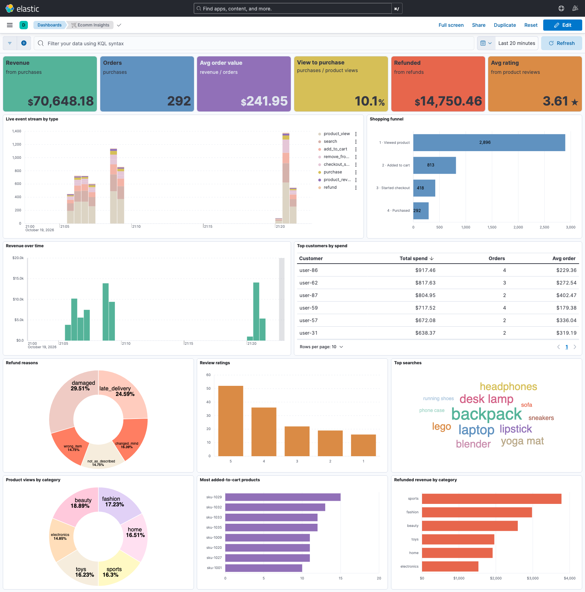

# 🛒 E-commerce Data Insights Platform

This project is a local event streaming playground for experimenting with Kafka, Schema Registry, Kafka Connect and Elasticsearch, fed by producers that emit fabricated e-commerce events (like an online shop).

Imagine orders from an online e-commerce site get emitted to Kafka. This data architecture is designed to process and ingest web orders at scale in real time. The targeted data marts are highly reliable for quick data-driven insights on products and customers. Insights Dashboard provides reports on which customers spent the most and which products earned and sold the most.



## 🏗️ Architecture

```
 +-------------+     Avro      +--------------+    ES sink     +---------------+     +--------+
 | producer    | ------------> |    Kafka     | -------------> | Elasticsearch | --> | Kibana |
 | (fake data) |               | topic/event  |  Kafka Connect |  alias/event  |     |        |
 +-------------+               +--------------+                +---------------+     +--------+
        |                             |
        +------- Schema Registry -----+
```

| Service         | From your laptop          | From containers              |
|-----------------|---------------------------|------------------------------|
| Kafka           | `localhost:29092`         | `kafka:9092`                 |
| Schema Registry | http://localhost:8081     | http://schema-registry:8081  |
| Kafka Connect   | http://localhost:8083     | http://connect:8083          |
| Elasticsearch   | http://localhost:9200     | http://elasticsearch:9200    |
| Kibana          | http://localhost:5601     |                              |
| Insights dashboard | http://localhost:5601/app/dashboards#/view/ecomm-insights | |

## 📦 Quick start

Requirements: Docker (with ~6 GB RAM allotted), `make`, `jq`, `curl`. Optional, for monitoring: [`kafkactl`](https://deviceinsight.github.io/kafkactl/), `tmux`, `watch` and `lazydocker`:

```bash
brew install deviceinsight/packages/kafkactl tmux watch lazydocker
```

```bash
make dev        # start infra, bootstrap topics/schemas/ES, create sinks and the Kibana dashboard
make produce    # send 20 add_to_cart events
make es-count   # see them land in Elasticsearch
```

Run `make` with no arguments to list every target. The common ones:

| Command | What it does |
|---|---|
| `make up` / `make down` | Start (waiting for healthchecks) / stop the infrastructure |
| `make reset` | Wipe all containers **and volumes**, then start fresh |
| `make bootstrap` | Create topics, register schemas, create ES ILM policies, templates and write aliases. Safe to re-run. |
| `make sink` | Create or update every connector in `apps/connect/connectors/` |
| `make produce EVENTS=add_to_cart,search COUNT=50 INTERVAL=0.1` | Send a fixed number of events. `EVENTS=all` uses every event type. |
| `make stream EVENTS=all` | Produce forever (Ctrl-C to stop) |
| `make ps` / `make logs SVC=connect` | Service health / tail logs |
| `make connectors` / `make sink-status` | Connector states / full status with task stack traces |
| `make topics` / `make subjects` / `make tail TOPIC=search-events` | Inspect Kafka, Schema Registry and decoded Avro messages |
| `make es-indices` / `make es-count` | Inspect Elasticsearch |
| `make build` | Rebuild the Python images after changing a `requirements.txt` |

The `bin/` scripts are still available for finer control: `bin/bootstrap`, `bin/stream`, and `bin/kc` (Kafka Connect).

### Development loop

* Python code in `common/` and `apps/*/src/` is volume-mounted into the containers, so edits take effect on the next `make produce` / `make bootstrap` without a rebuild.
* `docker compose up -d` only starts infrastructure. `bootstrap` and `producer` are one-shot tools behind the `tools` compose profile and run via `docker compose run --rm`.
* Connection settings in `common/settings.py` read `KAFKA_BOOTSTRAP_SERVERS`, `SCHEMA_REGISTRY_URL` and `ELASTICSEARCH_URL`, so the apps can also run directly on your laptop against the laptop-side endpoints above.
* Set `LOG_LEVEL=DEBUG` on the producer to see per-message delivery reports.

## 🔭 Observing the whole pipeline

```bash
make dev        # once, if the stack isn't up
make observe    # streams all event types; or: bin/observe --events search --interval 0.2
```

This opens a tmux session called `ecomm-observe` with three windows:

```
 window "pipeline"              window "health"                window "docker"
+-------------+-------------+  +--------------------------+  +----------------+
| 1 producer  | 2 kafka     |  | kafka-connect ERROR/WARN |  |   lazydocker   |
+-------------+-------------+  +--------------------------+  |                |
| 3 sink lag  | 4 ES counts |  | container CPU / memory   |  |                |
+-------------+-------------+  +--------------------------+  +----------------+
```

Follow one event through the panes. It is produced in **1**, decoded from Kafka in **2**, lag in **3** rises then returns to 0, and the count in **4** goes up. The first pane where the event stops showing up is where the problem is. Panes 3 and 4 cover every event type.

| Option | Default | Purpose |
|---|---|---|
| `--events` / `EVENTS=` | `all` | Event types to stream: a name, comma list, or `all` |
| `--interval` / `INTERVAL=` | `0.5` | Seconds between events |
| `--topic` / `TOPIC=` | `add-to-cart-events` | Topic shown in pane 2 |
| `--every` / `EVERY=` | `2` | Refresh rate of panes 3 and 4 |
| `--no-produce` | | Open the dashboard without starting the producer |

tmux keys (prefix is `Ctrl-b`): `prefix n`/`p` switches windows, `prefix z` zooms a pane, `prefix d` detaches and leaves everything running. The mouse works for selecting and resizing panes. Run `make observe` again to re-attach, and `make observe-kill` to close it all, including the producer.

Every pane is a normal make target, so you can also run any of them alone in your own shells:

| Command | Shows |
|---|---|
| `make stream EVENTS=all` | Producer output |
| `make kctl-follow TOPIC=...` | Messages arriving in Kafka |
| `make sink-lag-watch` | Lag of every ES sink in one table (`make sink-lag` for one snapshot) |
| `make es-watch` | Elasticsearch document counts |
| `make connect-errors` | Kafka Connect ERROR/WARN lines only |
| `make stats` | CPU and memory per container |
| `make docker-ui` | lazydocker: logs, restarts and shells for every container |

For the business view, keep the [Kibana dashboard](#-kibana-dashboard) open beside it. It refreshes every 10 seconds.

## 📈 Monitoring with kafkactl

The repo ships a [`kafkactl.yml`](kafkactl.yml) with an `ecomm-local` context pointing at `localhost:29092` and the Schema Registry, so Avro messages are decoded to JSON. The `make kctl-*` targets always use it, so your personal kafkactl config is never touched.

| Command | What it shows |
|---|---|
| `make kctl-topics` | Every topic with partition count, replication factor and non-default configs |
| `make kctl-topic TOPIC=search-events` | Oldest/newest offset per partition, i.e. how many messages a topic holds |
| `make kctl-groups` | Consumer groups, their type and the topics they read |
| `make kctl-group GROUP=<name>` | Committed offset, lag and connected members for one group |
| `make kctl-lag` | Lag per partition for every consumer group |
| `make kctl-watch` | Live lag for `GROUP`, refreshed every `EVERY` seconds |
| `make kctl-consume TOPIC=purchase-events MAX=5` | The last `MAX` messages, with key and timestamp |
| `make kctl-follow TOPIC=purchase-events` | New messages as they arrive |

`GROUP` defaults to `connect-add_to_cart_es_sink`. Each event's sink is a connector named `<event>_es_sink`, and Kafka Connect names its consumer group `connect-<connector name>`, e.g. `GROUP=connect-refund_es_sink`.

### Reading consumer lag

```
TOPIC                PARTITION  NEWEST_OFFSET  OLDEST_OFFSET  CONSUMER_OFFSET  LEAD  LAG
add-to-cart-events   0          24             0              14               14    10
```

* **NEWEST_OFFSET** is the offset the next produced message will get.
* **CONSUMER_OFFSET** is the last offset the group has *committed*.
* **LAG** is the difference, i.e. messages produced but not yet processed by the group.

A lag that keeps growing means the consumer is stuck or too slow; check `make sink-status`. A lag that briefly rises and returns to 0 is normal.
Kafka Connect commits sink offsets every 10 seconds here (`CONNECT_OFFSET_FLUSH_INTERVAL_MS` in `apps/connect/config/env`), so lag can trail Elasticsearch by up to that long.

To watch the sink catch up, pause it, produce, then resume:

```bash
bin/kc pause add_to_cart
make produce COUNT=50
make kctl-group            # LAG = 50
bin/kc resume add_to_cart
make kctl-watch            # LAG drains to 0
```

### Using kafkactl directly

Pass the repo config and context explicitly. kafkactl v5 stores the active context in a separate global file, so the `current-context` inside `kafkactl.yml` alone is not enough.

```bash
alias kk='kafkactl -C kafkactl.yml --context ecomm-local'

kk get topics
kk describe topic add-to-cart-events
kk get consumer-groups --topic add-to-cart-events
kk describe consumer-group connect-add_to_cart_es_sink --only-with-lag
kk consume search-events --from-beginning --max-messages 5 --exit
kk consume purchase-events --from-timestamp 2026-10-15T00:00:00Z --exit
kk reset consumer-group-offset <group> --topic <topic> --oldest --execute   # replay (stop the consumer first)
```

To use plain `kafkactl` anywhere, copy the `ecomm-local` context into `~/.config/kafkactl/config.yml` and run `kafkactl config use-context ecomm-local`.

## ⚙️ Layout

| Path | Purpose |
|---|---|
| `common/events/*.py` | Event classes: fields (Avro + ES types), topic, fake-data generator |
| `common/registry.py` | Registry of event names to classes |
| `common/settings.py` | Shared connection settings (env-overridable) |
| `apps/bootstrap/` | Creates topics, schemas and ES resources from the registry |
| `apps/producer/` | Streams generated events to Kafka as Avro |
| `apps/bootstrap/src/connect.py` | Generates one Elasticsearch sink connector per registered event |
| `apps/bootstrap/src/kibana.py` | Generates the Kibana data views and the Ecomm Insights dashboard |
| `apps/connect/connectors/*.json` | Optional hand-written connectors, applied by `make sink` |
| `apps/connect/plugins/` | Elasticsearch sink connector jars |

## 🧾 Event types

| Event | Topic | Weight | Notable fields |
|---|---|---|---|
| `product_view` | `product-view-events` | 10 | product, category, price |
| `search` | `search-events` | 5 | query, filters, results_count |
| `add_to_cart` | `add-to-cart-events` | 3 | product, quantity |
| `remove_from_cart` | `remove-from-cart-events` | 1.5 | product, category, quantity |
| `checkout_started` | `checkout-started-events` | 1.5 | cart_id, product_ids, item_count, cart_value |
| `purchase` | `purchase-events` | 1 | order_id, amount, currency |
| `refund` | `refund-events` | 0.2 | order_id, product, amount, reason |
| `product_review` | `product-review-events` | 0.5 | product, rating 1-5, title and body as full text, verified_purchase |

`bin/stream list` prints the same list from the registry.

* **Weight** is the relative frequency when one producer streams several types, so `EVENTS=all` looks like real traffic: mostly views and searches, very few refunds.
* **Shared catalog.** Every event draws customers and products from `common/events/catalog.py`. A SKU always has the same price and category. Activity is skewed like a real shop: 100 loyal customers and 40 bestsellers get a large share of events, so "top customers" and "top products" are meaningful.
* **One time field.** Every document gets a `@timestamp` date from the `events-enrich` ingest pipeline. It is copied from `timestamp`, `viewed_at` or `searched_at`, or set to the ingest time. The original events still store their own time fields as `keyword`, so use `@timestamp` for time filters.
* **Document ids.** Sinks use the Kafka key, which is the `event_id`, as the Elasticsearch `_id`. Replays overwrite instead of duplicating, and wiping Kafka can't clobber older documents.

### Searching across event types

Bootstrap adds read-only search aliases on top of each event's own alias:

| Alias | Covers |
|---|---|
| `events` | All event types |
| `events-browsing` | product_view, search |
| `events-cart` | add_to_cart, remove_from_cart, checkout_started |
| `events-orders` | purchase, refund |
| `events-feedback` | product_review |
| `<event>` | One event type, e.g. `refund` (this is also the sink's write alias) |

```bash
make es-search Q='user_id:user-42'                     # one customer's whole journey
make es-search Q='reason:damaged OR rating:1' SIZE=10   # unhappy customers, across event types
curl -s 'localhost:9200/events-orders/_search?q=amount:>400&sort=@timestamp:desc' | jq .
```

A domain comes from the event class's `domain` attribute. Index templates attach the aliases, so rolled-over indices join automatically.

### Running several producers

One producer can stream any mix of types, and you can run as many as you like in separate shells:

```bash
make stream EVENTS=all INTERVAL=0.1                        # realistic weighted mix
make stream EVENTS=product_view,search INTERVAL=0.05      # browsing traffic
make stream EVENTS=checkout_started,purchase,refund        # order lifecycle
```

## 🛠️ Adding new events

1. Create a class in `common/events/` that extends `EventBase`, with `name`, `topic`, `fields`, `generate()`, and optionally `weight` and `domain` (which `events-<domain>` alias it joins). Use the helpers in `catalog.py` for ids, users, products and timestamps.
2. Add it to the list in `common/registry.py`.
3. Run `make bootstrap && make sink`.

That creates its topic, Avro schema, ES ILM policy, template and write alias, and its `<event>_es_sink` connector. No connector JSON is needed. The sink writes to the alias (`external.resource.usage: ALIAS_INDEX`), so documents land in the ILM-managed `<event>_v1-000001` index. Connector 15.x ignores the old `topic.index.map` setting and rejects topic-renaming transforms.

Changing the fields of an event that already exists will be rejected by Schema Registry unless the change is backward compatible. For example, a new field needs a default. During local development, `make reset` starts over.

## 📊 Kibana dashboard

`make dev` creates it, and `make dashboards` re-creates it on its own:
http://localhost:5601/app/dashboards#/view/ecomm-insights


| Row | Panels |
|---|---|
| KPIs | Revenue, orders, average order value, view-to-purchase conversion, refunded amount, average rating |
| Traffic | Live event stream by type, shopping funnel from view to cart to checkout to purchase |
| Money | Revenue over time, top customers by spend |
| Sentiment | Refund reasons, review ratings, top search terms |
| Products | Product views by category, most added-to-cart products, refunded revenue by category |

It shows the last 30 minutes and auto-refreshes every 10 seconds. Run `make observe` alongside it to watch it move. Bootstrap also creates a data view per search alias for exploring raw documents in Discover. For example, "Orders events" is purchases plus refunds.

The dashboard is generated by `apps/bootstrap/src/kibana.py`, so it's reproducible. To change a panel, edit `panels()` and run `make dashboards`. That overwrites the dashboard. To customise it by hand in Kibana, use **Save as** so your copy survives.

## 🎨 Example event (ProductView)

```python
class ProductViewEvent(EventBase):
    name = "product_view"
    topic = "product-view-events"

    fields = [
        {"name": "event_id", "kafka_type": "string", "es_type": "keyword"},
        {"name": "user_id", "kafka_type": "string", "es_type": "keyword"},
        {"name": "category", "kafka_type": "string", "es_type": "keyword"},
        {"name": "price", "kafka_type": "float", "es_type": "float"},
        # ...
    ]

    @classmethod
    def generate(cls):
        return {
            "event_id": str(uuid.uuid4()),
            "user_id": f"user-{random.randint(1, 5000)}",
            "category": random.choice(["electronics", "fashion", "home", "toys"]),
            "price": round(random.uniform(10, 500), 2),
            # ...
        }
```

## 🩺 Troubleshooting

* **A service never turns healthy.** Run `make ps`, then `make logs SVC=<name>`. Elasticsearch and Connect need the most memory.
* **Connector task is FAILED.** `make sink-status SINK=<event>` shows the stack trace. Fix the cause, then `make sink` and `bin/kc restart <event>`.
* **Bootstrap fails on Elasticsearch after an alias was deleted manually.** Run `make reset` to start from clean volumes.
* **kafkactl hangs or reports `connection refused` on 9092.** Your context points at the container-internal port. Use `localhost:29092`.
* **Port already in use.** Another local Kafka/ES is running. Stop it, or change the left-hand port in `docker-compose.yml`.

## 🔮 Roadmap

* Migrate the original events' own time fields from `keyword` to `date` (needs new indices)
* Add Postgres consumers
* Add Flink streaming jobs
* Add Grafana dashboards for infrastructure metrics
